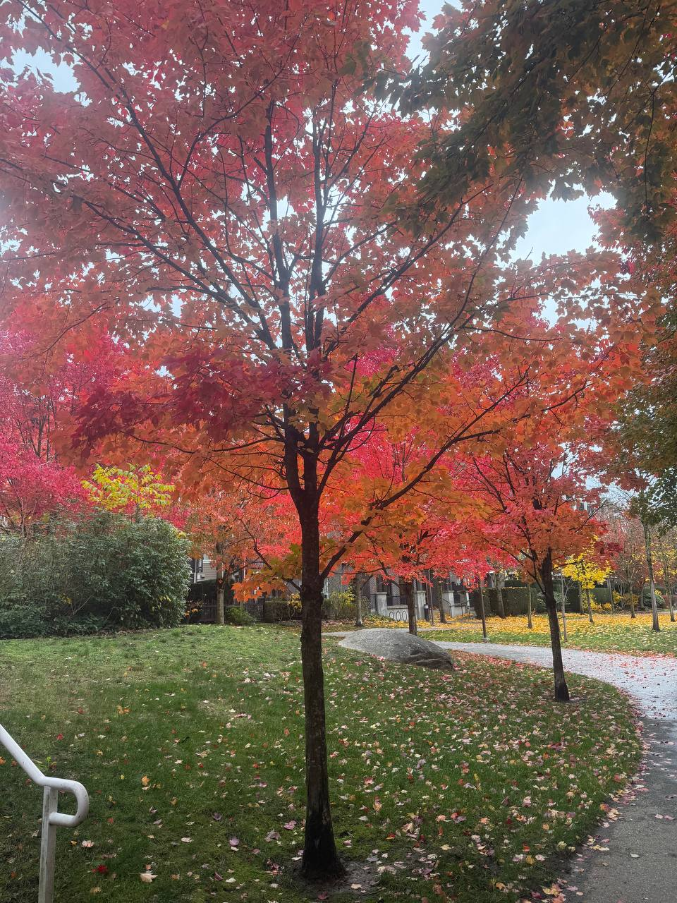

+++
title = "枫叶国的秋"
date = 2026-11-08T13:06:00-07:00
lastmod = 2026-11-08T16:05:48-07:00
tags = ["canada", "life"]
categories = ["旅加经历"]
draft = false
toc = true
showQuote = true
+++

## 1 广东的秋 {#广东的秋}

对于在广东长大的朋友来说，秋天是个熟悉又陌生的季节，在课本上读到非常多关于秋天的词句与诗篇。

比如「自古逢秋悲寂寥，我言秋日胜春朝」称颂秋天的壮美

又或者「停车坐爱枫林晚，霜叶红于二月花」描述秋叶的绚烂。

但是广东没有秋天，只有十个月的夏天，和伴随冷空气突如其来的短暂冬天。

我也没有机会切实体会到「无边落木萧萧下」的意境，毕竟在广东的树木都是一年四季常绿的。

## 2 加拿大的秋 {#加拿大的秋}

不知不觉，今年已经是来加拿大的第4个年头了，之前我还写过一篇春天的文章：《[三月的樱花](https://ramsayleung.github.io/zh/post/2024/%E4%B8%89%E6%9C%88%E7%9A%84%E6%A8%B1%E8%8A%B1/)》

我居住的城市温哥华纬度非常高，对应的中国城市位置相当于黑龙江省黑河市

尽管纬度极高，但由于受太平洋暖流，以及东面落基山脉阻挡了西伯利亚的极寒冷空气，温哥华的冬天相当温和，远比同纬度的中国北方暖和得多

只是相应，温哥华的冬天就非常多雨，甚至持续数个月之久，所以在温哥华也很少看到秋天，夏天结束后开始下雨，冬天就来了。

今天却与往年不同，到11月雨季都还没有来，我也终于有机会领略加拿大的秋。

### 2.1 枫叶 {#枫叶}

今年夏天换了个公寓，新公寓客厅窗户正对外面的枫树，我把升降桌搬到窗前，夏天的时候抬头就能看到满眼的绿色，非常解乏。

令我非常惊喜的，随着秋天步伐的临近，窗前的绿叶像沾满红墨水一样，突然红得亮丽











住的公寓附近住满了枫树，每天上下班，只需要抬头就能看到满眼红叶；而随着深秋的到来，红叶也逐渐被风刮到地上，踩上去就会有「沙沙」之响











### 2.2 三文鱼洄游 {#三文鱼洄游}

三文鱼洄游是在温哥华每年秋季看到的非常壮观的自然现象：

三文鱼出生在淡水河流中，长大后游到太平洋生活，成年后又跨越数千公里，回到自己出生的河流产卵。

今年雨季延迟，终于有机会去领略这生命的奇迹。

和朋友一起去 Coquitlam River Park, 到了公园之后发现，目力所见的水流处，都是三文鱼

眼前是一段布满岩石与枯木的湍急河道，水流从高处奔涌而下，激起层层白色浪花

而就在这片看似不可能逾越的急流中，三文鱼正奋力向上游进发。

我驻足观察了30分钟，成功越过急流的却只有寥寥几条。

以前只在故事里听过「鱼跃龙门」，今天才真正体会到这四个字的震撼。

三文鱼离开海洋之后，就停止进食了，所以它一直在消耗此前存储的能量，冲刺失败后却无法补充。

原来，生命真的可以如此顽强，壮丽。

<video width="720" height="480" controls><source src="/ox-hugo/canada_salmon1.mp4" type="video/mp4">
Your browser does not support the video tag.</video>

<video width="720" height="480" controls><source src="/ox-hugo/canada_salmon2.mp4" type="video/mp4">
Your browser does not support the video tag.</video>

<video width="720" height="480" controls><source src="/ox-hugo/canada_salmon3.mp4" type="video/mp4">
Your browser does not support the video tag.</video>

<video width="720" height="480" controls><source src="/ox-hugo/canada_salmon4.mp4" type="video/mp4">
Your browser does not support the video tag.</video>

<video width="720" height="480" controls><source src="/ox-hugo/canada_salmon5.mp4" type="video/mp4">
Your browser does not support the video tag.</video>

<video width="720" height="480" controls><source src="/ox-hugo/canada_salmon6.mp4" type="video/mp4">
Your browser does not support the video tag.</video>

往主河道走去，就能发现更多的三文鱼，真的是多到拿根棒子都能随便打到鱼，望着流淌的河流， 我难免会想起《动物世界》的场景，总感觉河的尽头会有头熊守在那里，在河边捞鱼吃。

（神奇的是，有朋友在我的推荐之下也来了这个公园看三文鱼，真的看到有一家三口的黑熊出门捕鱼）

<video width="720" height="480" controls><source src="/ox-hugo/canada_salmon7.mp4" type="video/mp4">
Your browser does not support the video tag.</video>

<video width="720" height="480" controls><source src="/ox-hugo/canada_salmon8.mp4" type="video/mp4">
Your browser does not support the video tag.</video>

继续沿着河道走，我来到了 Blue Bridge, 也看到了最美的秋景。



秋水长流，层林渐染。阳光恰好，秋意正浓。

黄叶在秋风的欢送下，轻轻落入河面，随着流水缓缓漂向远方。
顺着落叶飘去的方向望下，清澈的河水中，竟是成群的三文鱼，摆动着尾巴，奋力逆流而上。

一边是随波逐流的落叶，一边是迎流而上的生命。一个告别枝头，一个奔赴故乡。

原来，秋天不仅是万物凋零的季节，也是生命归来的时节。

<video width="720" height="480" controls><source src="/ox-hugo/canada_salmon9.mp4" type="video/mp4">
Your browser does not support the video tag.</video>
